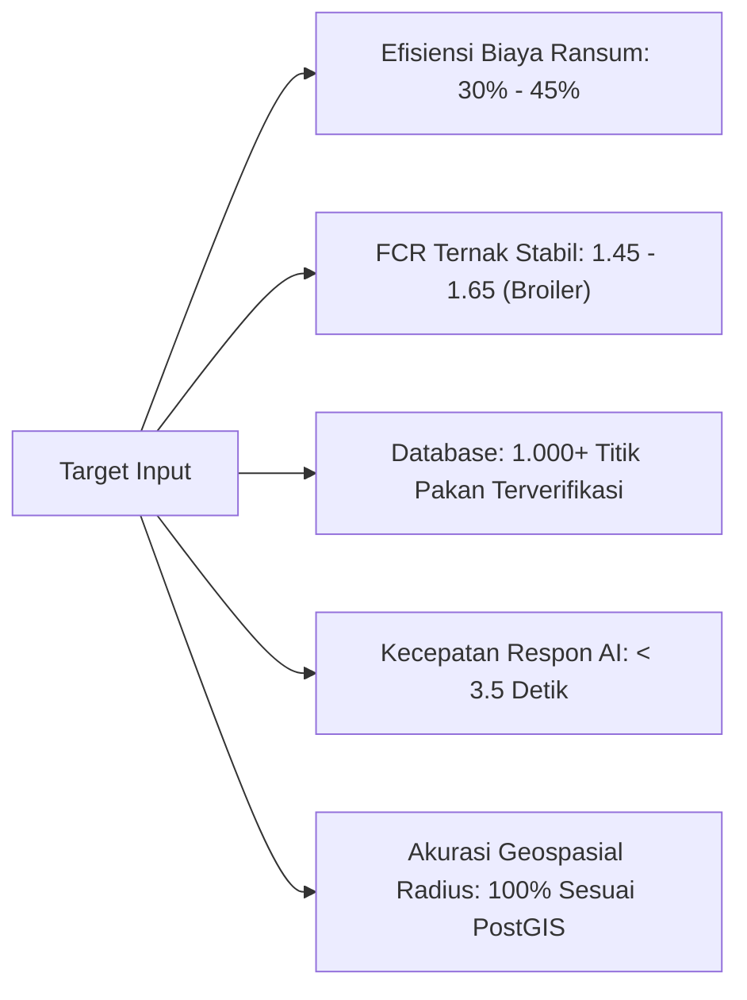
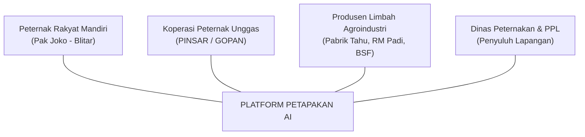
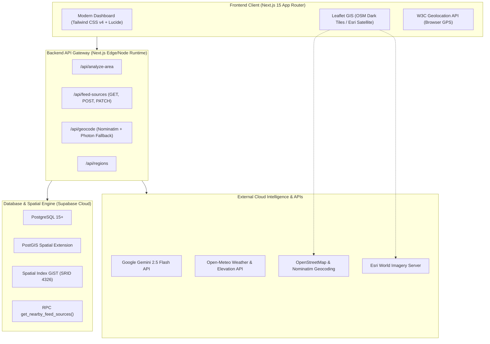
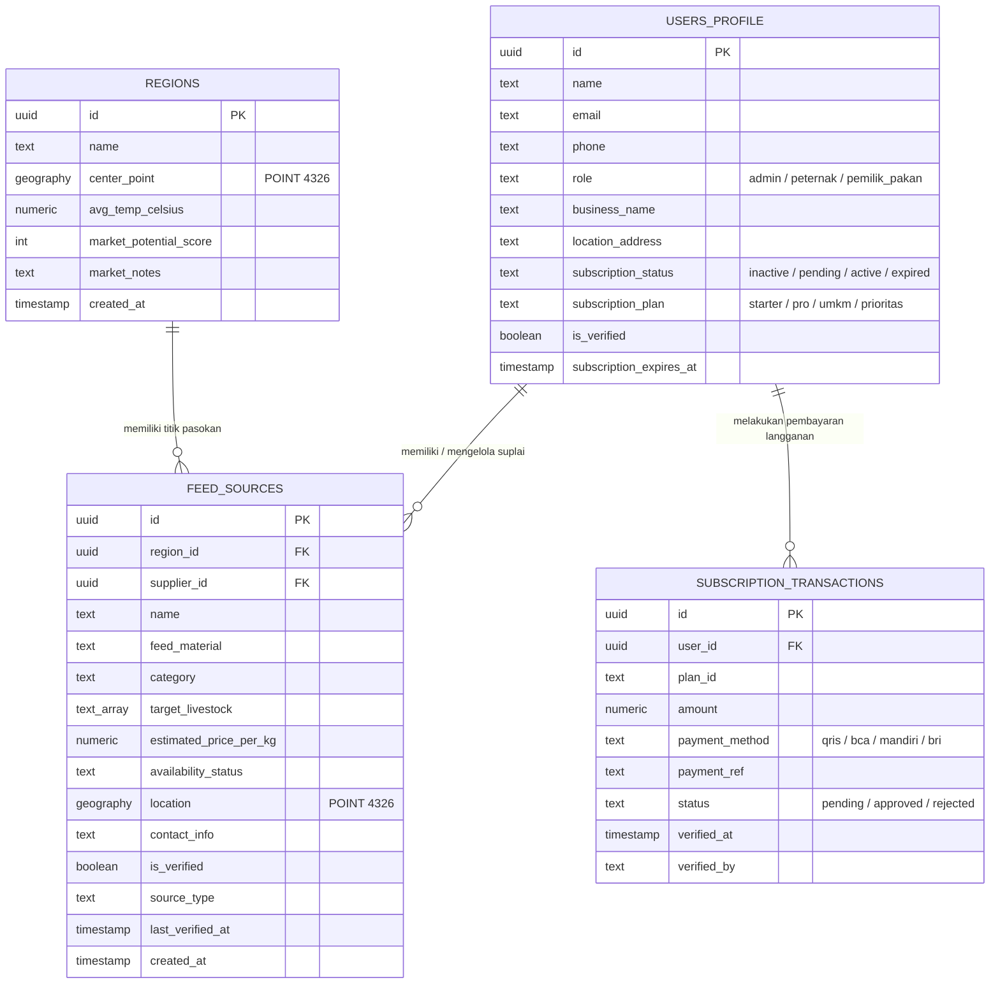
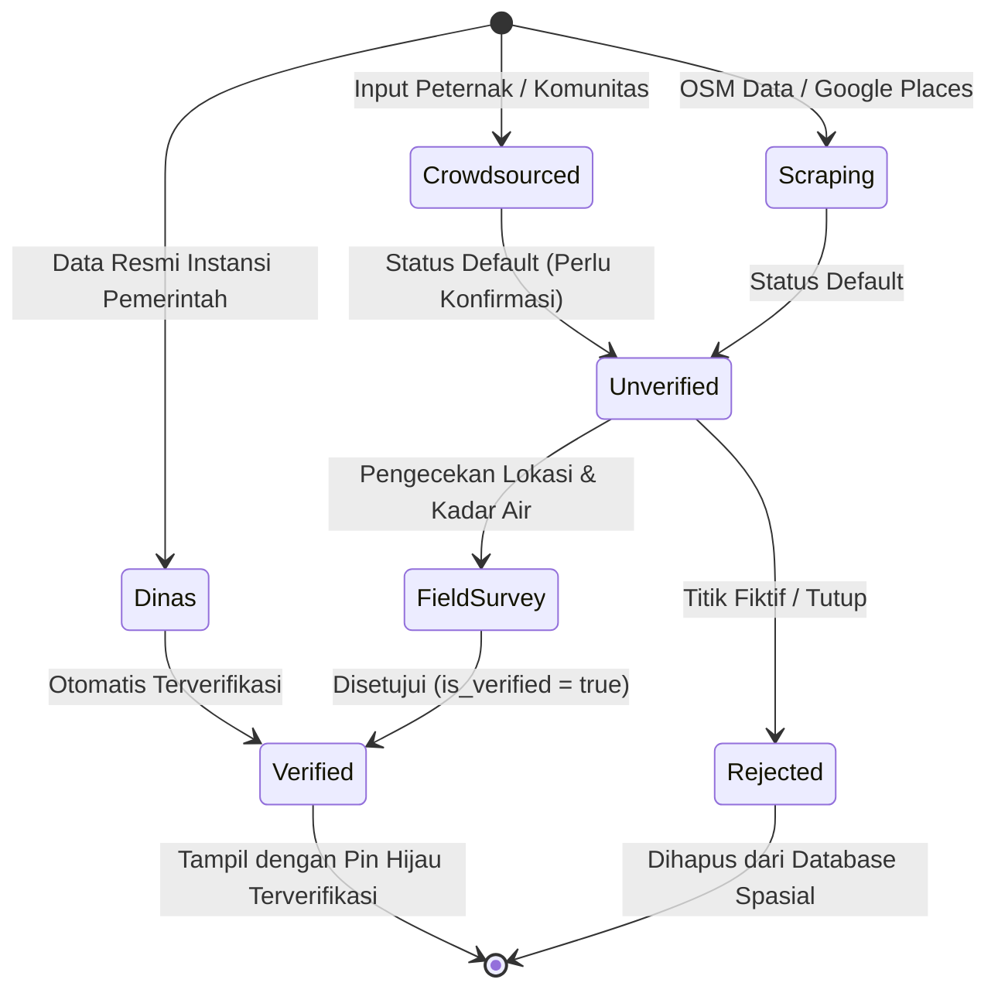
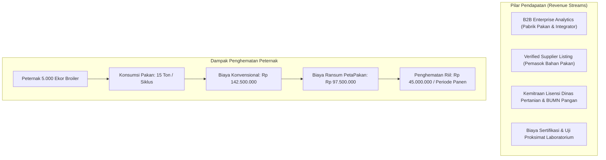
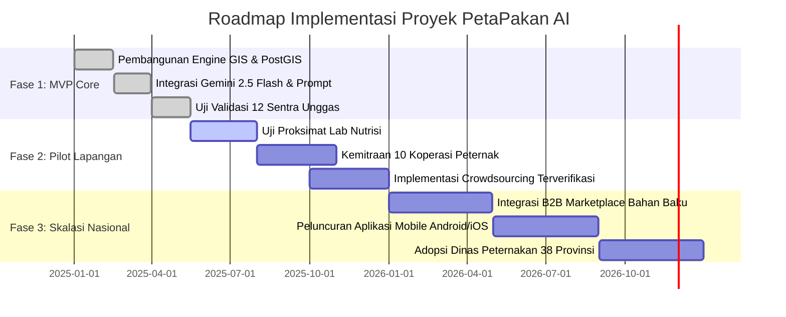

# PRODUCT REQUIREMENTS DOCUMENT (PRD)

---

## **PetaPakan AI**
### *Sistem Geospasial Pemetaan Potensi Wilayah & Rekomendasi Pakan Alternatif Unggas Berbasis Kecerdasan Buatan (AI)*

---

| **Atribut Dokumen** | **Keterangan** |
| :--- | :--- |
| **Nama Produk** | PetaPakan AI (*Poultry Feed Precision & Spatial Decision Support System*) |
| **Versi Dokumen** | 1.0 (Final - Siap Proposal Hibah / Investasi / Kerjasama) |
| **Status Produk** | Production-Ready MVP (Next.js 15, PostGIS, Google Gemini 2.5 Flash) |
| **Fokus Komoditas** | Unggas Seluruh Indonesia (*Broiler, Layer, Ayam Kampung/Joper, Bebek/Itik, Puyuh*) |
| **Klasifikasi Proyek** | *Agritech / Livestock Precision Technology / Spatial Decision System* |
| **Target Tanggal Rilis** | Q1 - Q2 2025 / 2026 |

---

## DAFTAR ISI
1. [Ringkasan Eksekutif (Executive Summary)](#1-ringkasan-eksekutif-executive-summary)
2. [Latar Belakang & Analisis Masalah (Problem Statement)](#2-latar-belakang--analisis-masalah-problem-statement)
3. [Visi, Misi, & Proposisi Nilai (Value Proposition)](#3-visi-misi--proposisi-nilai-value-proposition)
4. [Sasaran Proyek & Key Performance Indicators (KPIs)](#4-sasaran-proyek--key-performance-indicators-kpis)
5. [Profil Pengguna & Pemangku Kepentingan (User Personas)](#5-profil-pengguna--pemangku-kepentingan-user-personas)
6. [Cakupan Produk & Ruang Lingkup (Scope of Work)](#6-cakupan-produk--ruang-lingkup-scope-of-work)
7. [Spesifikasi Kebutuhan Fungsional (Functional Requirements)](#7-spesifikasi-kebutuhan-fungsional-functional-requirements)
8. [Spesifikasi Kebutuhan Non-Fungsional (Non-Functional Requirements)](#8-spesifikasi-kebutuhan-non-fungsional-non-functional-requirements)
9. [Arsitektur Sistem & Spesifikasi Teknologi (Technical Architecture)](#9-arsitektur-sistem--spesifikasi-teknologi-technical-architecture)
10. [Desain Basis Data & Skema Spasial PostGIS](#10-desain-basis-data--skema-spasial-postgis)
11. [Alur Logika & AI Prompt Engineering Guidelines](#11-alur-logika--ai-prompt-engineering-guidelines)
12. [Integritas Data & Mekanisme Validasi Titik Pakan](#12-integritas-data--mekanisme-validasi-titik-pakan)
13. [Analisis Kelayakan Finansial & Model Bisnis (Business Model)](#13-analisis-kelayakan-finansial--model-bisnis-business-model)
14. [Rencana Anggaran Biaya (RAB) Proposal](#14-rencana-anggaran-biaya-rab-proposal)
15. [Roadmap Pengembangan & Rencana Implementasi](#15-roadmap-pengembangan--rencana-implementasi)
16. [Analisis & Mitigasi Risiko (Risk Management)](#16-analisis--mitigasi-risiko-risk-management)

---

## 1. Ringkasan Eksekutif (Executive Summary)

Sektor peternakan unggas merupakan tulang punggung penyedia protein hewani terjangkau bagi masyarakat Indonesia (menyumbang lebih dari 65% konsumsi daging dan hampir 100% konsumsi telur nasional). Namun, **biaya pakan menyerap 65% hingga 75% dari total biaya operasional peternak**. Ketergantungan yang tinggi terhadap bahan baku konsentrat impor—seperti *Soybean Meal* (SBM / Bungkil Kedelai) dan tepung ikan impor—serta volatilitas harga jagung pakan lokal secara berkala memukul marjin keuntungan peternak rakyat mandiri.

Di sisi lain, Indonesia menghasilkan jutaan ton biomassa sampingan pertanian, perkebunan, dan limbah agroindustri lokal (dedak padi, ampas tahu, bungkil inti sawit, limbah sortiran ikan/rajungan, tepung darah, hingga maggot BSF) yang tersebar di pedesaan. Pemanfaatan bahan baku lokal ini terhambat oleh **tiga kendala fundamental**:
1. **Asimetri Informasi Geografis:** Peternak tidak memiliki akses peta ketersediaan, jarak tempuh logistik, dan transparansi harga pemasok limbah di sekitar radius kandang mereka.
2. **Keterbatasan Formulasi Nutrisi Unggas:** Karakteristik sistem pencernaan unggas (*monogastrik*) sangat sensitif terhadap serat kasar (< 5.5%) dan membutuhkan rasio Energi Metabolis (EM) serta Asam Amino esensial yang presisi. Peternak rakyat kerap gagal meramu pakan mandiri karena FCR (*Feed Conversion Ratio*) memburuk atau produksi telur merosot.
3. **Faktor Agroklimat & Heat Stress:** Suhu tropis Indonesia yang kerap menembus > 28°C–33°C menekan nafsu makan unggas (*heat stress*), sehingga komposisi ransum dan waktu pemberian pakan memerlukan penyesuaian mikroklimat wilayah secara dinamis.

**PetaPakan AI** hadir sebagai platform *Spatial Decision Support System* (SDSS) berbasis Web GIS terintegrasi Artificial Intelligence pertama di Indonesia yang didedikasikan khusus untuk komoditas unggas. Melalui penggabungan **PostgreSQL/PostGIS**, **Leaflet Geospasial**, data cuaca **Open-Meteo**, dan model AI **Google Gemini 2.5 Flash**, platform ini memetakan titik pasokan pakan alternatif terverifikasi dalam radius 5–30 km, menganalisis agroklimat real-time, dan mengenerasi rekomendasi ransum pakan presisi yang terbukti mampu **menghemat biaya pakan 30% hingga 45%** tanpa menurunkan produktivitas ternak.

---

## 2. Latar Belakang & Analisis Masalah (Problem Statement)

```
+-----------------------------------------------------------------------------------+
|                            POHON MASALAH PETERNAKAN UNGGAS                        |
+-----------------------------------------------------------------------------------+
                                        |
                 +----------------------+----------------------+
                 |                                             |
        [ KETERGANTUNGAN IMPOR ]                     [ ASIMETRI INFORMASI SPASIAL ]
  - SBM & Tepung Ikan fluktuatif USD          - Lokasi limbah pakan lokal tercecer
  - Biaya pakan 65-75% modal kerja             - Tengkulak mempermainkan harga pasokan
  - Peternak mandiri rentan gulung tikar       - Peternak tidak tahu potensi dalam radius 15km
                 |                                             |
                 +----------------------+----------------------+
                                        |
                 +----------------------+----------------------+
                 |                                             |
        [ RESIKO FORMULASI GAGAL ]                   [ TEKANAN AGROKLIMAT (HEAT STRESS) ]
  - Saluran cerna unggas pendek (monogastrik)  - Suhu > 28°C menurunkan konsumsi pakan
  - Serat kasar tinggi (>6%) sebabkan mencret  - Sintesis kalsium kerabang telur terganggu
  - Kurang enzim/fermentasi rusak nutrisi       - Mortalitas tinggi tanpa adaptasi pakan
```

### 2.1. Akar Masalah Industri Unggas Nasional
1. **Volatilitas Harga Pakan Pabrikan:** Kenaikan harga pakan komersial dari Rp 7.500/kg menjadi Rp 9.500 - Rp 11.500/kg dalam 3 tahun terakhir mempersempit *break-even point* (BEP) peternak rakyat.
2. **Potensi Biomassa Lokal Terabaikan:** Puluhan jenis hasil samping agroindustri bernilai nutrisi tinggi terbuang percuma atau mencemari lingkungan karena tidak terhubung dengan ekosistem peternakan.
3. **Tingginya Biaya Logistik:** Pakan yang didatangkan dari luar pulau atau luar kabupaten membebani ongkos kirim. Dibutuhkan sistem pencarian radius terdekat (5–30 km) agar efisiensi biaya tercapai.
4. **Ketiadaan Asisten Formulasi Ransum:** Konsultan nutrisi hewan (*animal nutritionist*) berbiaya mahal dan hanya dapat dijangkau perusahaan peternakan skala konglomerasi (*integrator*). Peternak rakyat membutuhkan kecerdasan buatan instan yang mampu menghitungkan ransum berbasis bahan lokal yang tersedia saat itu juga.

---

## 3. Visi, Misi, & Proposisi Nilai (Value Proposition)

### 3.1. Visi
Menjadi platform intelijen geospasial dan kecerdasan buatan pakan ternak nomor satu di Indonesia yang mewujudkan kedaulatan pakan lokal, meningkatkan marjin keuntungan peternak rakyat, dan menggerakkan ekonomi sirkular (*circular economy*).

### 3.2. Misi
1. Memetakan 100% potensi bahan pakan alternatif dan limbah agroindustri bernutrisi tinggi di seluruh sentra peternakan Indonesia.
2. Mendemokratisasi ilmu formulasi ransum unggas presisi melalui antarmuka AI yang mudah dipahami peternak dari berbagai latar belakang pendidikan.
3. Menghubungkan peternak langsung dengan produsen limbah agroindustri lokal melalui jalur komunikasi langsung tanpa perantara.
4. Memberikan peringatan dini dan rekomendasi mitigasi agroklimat (*heat stress*) berbasis data cuaca real-time.

### 3.3. Nilai Kebaruan (Novelty) & Unique Value Proposition (UVP)
| Solusi Konvensional (Sebelumnya) | Inovasi PetaPakan AI |
| :--- | :--- |
| Tabel Excel manual atau perkiraan insting peternak. | **AI Engine Berbasis LLM:** Formulasi ransum instan dengan batasan biologis monogastrik yang presisi. |
| Peta statis PDF atau brosur dinas penyuluhan. | **Interactive Spatial GIS (PostGIS):** Pencarian radius dinamis 5–30 km dengan kalkulasi jarak nyata jalan/wilayah. |
| Tidak memperhitungkan cuaca setempat. | **Real-Time Agroklimat Integration:** Mengambil suhu mikro Open-Meteo untuk mitigasi *heat stress* otomatis. |
| Kontak penjual tidak jelas / perantara berantai. | **1-Click WhatsApp Direct Order:** Transparansi harga per kg dan komunikasi instan ke pemilik pasokan pakan. |
| Data sebatas kota besar. | **Cakupan Seluruh Indonesia:** Mendukung pencarian hingga tingkat desa/kecamatan di 38 provinsi. |

---

## 4. Sasaran Proyek & Key Performance Indicators (KPIs)



### 4.1. Sasaran Kuantitatif (Target 12 Bulan Pertama)
1. **Efisiensi Biaya Pakan:** Menurunkan pengeluaran pakan harian peternak mitra sebesar **30% hingga 45%** dibandingkan pemakaian 100% konsentrat pabrik.
2. **Kestabilan Performa Produksi:** Mempertahankan FCR (*Feed Conversion Ratio*) ayam pedaging pada rentang **1.45 – 1.65** dan persentase *Hen-Day Production* (HDP) ayam petelur di atas **82%**.
3. **Akuisisi Titik Pasokan:** Memetakan minimal **1.000 titik pemasok pakan lokal** terverifikasi di 5 pulau besar (Jawa, Sumatera, Sulawesi, Kalimantan, Bali-Nusa Tenggara).
4. **Waktu Akses Sistem:** *Latency response* pencarian spasial di bawah **1.5 detik** dan generasi ransum AI di bawah **3.5 detik**.

### 4.2. Sasaran Kualitatif
1. Terciptanya simbiosis mutualisme antara pabrik tahu/penggilingan padi/industri kelapa dengan peternak sekitar (limbah bernilai ekonomi).
2. Peningkatan literasi peternak mengenai pentingnya teknik fermentasi probiotik dan pemecahan serat kasar bagi unggas.
3. Terbentuknya basis data spasial pakan ternak nasional yang dapat diakses oleh pembuat kebijakan (Kementerian Pertanian / Dinas Peternakan).

---

## 5. Profil Pengguna & Pemangku Kepentingan (User Personas)



### 5.1. Persona 1: Peternak Rakyat Mandiri (Primary User)
- **Nama Representatif:** Pak Joko (46 Tahun), Peternak Layer & Broiler Mandiri (Kapasitas 4.000 ekor di Blitar, Jawa Timur).
- **Karakteristik:** Mengoperasikan kandang bersama keluarga, mengandalkan smartphone Android, sangat sensitif terhadap selisih harga pakan Rp 200/kg.
- **Pain Points:** Marjin tergerus saat harga jagung naik; tidak tahu ada pabrik bihun atau penggilingan beras murah 7 km dari desanya; takut meramu pakan sendiri karena takut ayam mencret atau telur lembek.
- **Goals:** Menemukan bahan baku berprotein murah di sekitarnya, mendapatkan takaran ransum yang pasti aman, dan langsung bisa kontak pemilik bahan via WhatsApp.

### 5.2. Persona 2: Produsen & Pengepul Limbah Agroindustri (Data Contributor / Supplier)
- **Nama Representatif:** Mas Dimas (32 Tahun), Pemilik Penggilingan Padi & Budidaya BSF (Pasuruan).
- **Pain Points:** Limbah dedak halus dan bekatul menumpuk di gudang; sering ditawar murah oleh tengkulak luar kota karena tidak kenal peternak langsung di kawasannya.
- **Goals:** Memasukkan titik lokasinya ke PetaPakan AI agar peternak langsung datang membeli dengan harga adil tanpa potongan perantara.

### 5.3. Persona 3: Koperasi Peternak & Asosiasi (PINSAR / GOPAN)
- **Peran:** Mengawasi stabilitas pasokan pakan anggota koperasi; membutuhkan agregasi data wilayah mana yang mengalami kelangkaan pakan atau bahan apa yang sedang berlimpah di suatu kabupaten.

### 5.4. Persona 4: Dinas Peternakan & Penyuluh Pertanian Lapangan (PPL)
- **Peran:** Memanfaatkan platform sebagai alat bantu konsultasi saat melakukan kunjungan lapangan (*field extension*) untuk mengedukasi peternak tentang formulasi ransum murah berkualitas.

---

## 6. Cakupan Produk & Ruang Lingkup (Scope of Work)

### 6.1. Dalam Ruang Lingkup (In-Scope)
- Pemetaan spasial interaktif seluruh wilayah Indonesia dengan dukungan multi-layer: Peta Vektor Gelap (*OpenStreetMap Dark Inverted*) dan Citra Satelit Resolusi Tinggi (*Esri World Imagery*).
- Pencarian geocoding cerdas untuk seluruh tingkatan wilayah (Provinsi, Kabupaten, Kecamatan, hingga Kelurahan/Desa) dengan fallback multi-provider (Nominatim & Photon Komoot).
- Deteksi lokasi terkini pengguna menggunakan W3C Geolocation API berbasis GPS perangkat.
- Dukungan 5 sub-komoditas unggas:
  1. Ayam Pedaging (*Broiler*)
  2. Ayam Petelur (*Layer / Hen-Day Production*)
  3. Ayam Kampung Super / Joper (*Dual-Purpose*)
  4. Bebek / Itik (*Petelur & Pedaging*)
  5. Burung Puyuh (*Coturnix*)
- Parameter nutrisi presisi khusus unggas: Protein Kasar (PK %), Energi Metabolis (EM kcal/kg), Serat Kasar (SK % < 5.5%), Kalsium (Ca %), dan Fosfor (P %).
- Analisis mikroklimat otomatis (suhu rerata °C dan elevasi mdpl) dari Open-Meteo API.
- Generasi panduan fermentasi mikroba (EM4 / Aspergillus / Trichoderma) dan mitigasi agroklimat (*heat stress*) berbasis LLM Gemini 2.5 Flash.
- Manajemen integritas data titik pakan dengan atribut status verifikasi (`is_verified`), asal data (`source_type`), dan stempel waktu audit.
- Hubungan rantai pasok langsung dengan 1-Click WhatsApp integration.

### 6.2. Di Luar Ruang Lingkup (Out-of-Scope - Direncanakan pada Fase 3)
- Transaksi pembayaran langsung di dalam aplikasi (*escrow / payment gateway*).
- Pelacakan armada truk pengiriman pakan secara real-time (*live GPS tracking fleet*).
- Integrasi perangkat keras sensor IoT kandang (kelembapan amonia, luxmeter cahaya).

---

## 7. Spesifikasi Kebutuhan Fungsional (Functional Requirements)

| Kode Kebutuhan | Nama Fitur | Deskripsi Fungsional & Kriteria Penerimaan | Prioritas |
| :--- | :--- | :--- | :--- |
| **FR-GEO-01** | *Spatial Radius Engine* | Sistem mampu menghitung titik pakan dalam radius 5 km hingga 30 km dari titik koordinat terpilih menggunakan query PostGIS `ST_DWithin` dan `ST_Distance`. Menampilkan visualisasi lingkaran radius pada peta. | **P0 (Must Have)** |
| **FR-GEO-02** | *Interactive Map & Dual-Layers* | Peta interaktif Leaflet bebas digeser, di-zoom, dan diklik untuk memindahkan titik fokus analisis secara instan. Tersedia tombol *toggle* lapisan Citra Satelit (*Esri World Imagery*) dan Peta Tematik Jalan (*OSM Dark*). | **P0 (Must Have)** |
| **FR-GEO-03** | *Universal Geocoding Search* | Kolom input pencarian yang mendukung *debounced search* (320ms) untuk seluruh nama desa, kecamatan, kota di Indonesia. Dilengkapi 12 *preset* sentra unggas nasional (Blitar, Ciamis, Sukabumi, Deli Serdang, Sidrap, Tabanan, dll). | **P0 (Must Have)** |
| **FR-GEO-04** | *W3C Device Geolocation* | Tombol navigasi GPS yang memanfaatkan `navigator.geolocation.getCurrentPosition` dengan opsi `enableHighAccuracy: true`. Sistem otomatis menggeser peta ke lokasi peternak dan memasang penanda khusus GPS. | **P0 (Must Have)** |
| **FR-AI-01** | *AI Nutrition Formulator* | Integrasi Google Gemini 2.5 Flash yang menerima payload titik pakan terdeteksi, jenis unggas, dan suhu lokal. Menghasilkan struktur JSON baku berisi ringkasan agroklimat, persentase ransum, nilai PK/EM/SK/Ca/P, tips fermentasi, dan strategi komersil. | **P0 (Must Have)** |
| **FR-AI-02** | *Heat Stress Mitigation Engine* | Jika suhu wilayah tercatat $\ge 28^\circ\text{C}$, AI secara otomatis menyisipkan protokol pemberian pakan pagi/malam, peningkatan densitas nutrisi, dan suplementasi elektrolit/vitamin C. | **P1 (Should Have)** |
| **FR-DATA-01** | *Multi-Source Data Tagging* | Setiap titik pakan memiliki atribut `source_type` (*survey_lapangan*, *google_places*, *komunitas*, *osm_data*, *data_pemerintah*) dan indikator visual status `is_verified` (Badge Terverifikasi vs Perlu Konfirmasi). | **P0 (Must Have)** |
| **FR-DATA-02** | *Feed Sourcing Crowdsourcing* | Modal form bagi peternak/pemasok untuk menambahkan titik pakan baru. Mendukung penarikan koordinat otomatis dari GPS perangkat atau klik langsung di peta. | **P0 (Must Have)** |
| **FR-DATA-03** | *Community Verification Toggle* | Filter pada daftar pakan untuk menyaring titik pakan hanya yang telah terverifikasi, serta tombol aksi cepat untuk memvalidasi titik pakan yang belum diverifikasi. | **P1 (Should Have)** |
| **FR-COMM-01** | *1-Click WhatsApp Direct Order* | Tautan pemesanan pada popup peta dan kartu daftar pakan yang langsung membuka WhatsApp pemasok dengan pesan yang sudah terformat rapi (mencakup nama pakan, estimasi tonase, dan referensi harga). | **P1 (Should Have)** |
| **FR-DASH-01** | *Admin Dashboard & Payment Verification* | Panel khusus administrator (`/admin`) untuk memverifikasi bukti transfer biaya langganan dari peternak dan pemilik pakan. Admin dapat menyetujui (*Approve*) atau menolak (*Reject*) pembayaran, mengaktifkan masa berlaku akun (30 hari), dan memberikan badge centang hijau resmi pada titik pakan secara otomatis. | **P0 (Must Have)** |
| **FR-DASH-02** | *Peternak Dashboard & Ransum Library* | Portal khusus peternak (`/dashboard/peternak`) yang menampilkan profil populasi kandang, kalkulator proyeksi penghematan biaya pakan bulanan, riwayat resep ransum AI tersimpan, status langganan (*Starter* / *Pro*), serta formulir pengajuan bukti pembayaran langganan. | **P0 (Must Have)** |
| **FR-DASH-03** | *Pemilik Pakan Dashboard & Catalog Management* | Portal khusus produsen limbah agroindustri/pemasok (`/dashboard/pemasok`) untuk mengelola katalog bahan pakan (harga/kg, kapasitas stok tonase), memantau statistik tayangan dan *leads* pemesanan WhatsApp dari peternak, status verifikasi lencana centang hijau, serta form pembayaran langganan kemitraan. | **P0 (Must Have)** |
| **FR-SUB-01** | *Subscription & Verification Lifecycle* | Sistem siklus biaya langganan berbayar: Peternak (Starter Rp 49.000 / Pro Rp 99.000) dan Pemilik Pakan (UMKM Rp 79.000 / Agroindustri Prioritas Rp 149.000). Status akun bertransisi dari `inactive` -> `pending_verification` -> `active` (setelah diverifikasi admin) -> `expired`. | **P0 (Must Have)** |


---

## 8. Spesifikasi Kebutuhan Non-Fungsional (Non-Functional Requirements)

### 8.1. Kinerja & Kecepatan (Performance)
- **Response Time Query Spasial:** Eksekusi fungsi PostGIS `get_nearby_feed_sources` harus selesai dalam waktu $\le 800\text{ ms}$ untuk pencarian hingga 500 titik data dengan memanfaatkan *Spatial Indexing* (`GiST`).
- **First Contentful Paint (FCP):** Tampilan dashboard web harus dapat berinteraksi (*Time to Interactive*) di bawah 2.0 detik pada jaringan seluler 4G.
- **Dynamic Leaflet Loading:** Komponen peta harus dimuat secara asinkron (`next/dynamic` dengan `ssr: false`) untuk mencegah *hydration mismatch* dan memastikan *bundle size* awal tetap ringan.

### 8.2. Keandalan & Mekanisme Failover (Reliability & Availability)
- **Sistem Fallback Berlapis (Graceful Degradation):**
  - Jika koneksi Supabase terputus, sistem otomatis mengaktifkan *Haversine formula client-side* dengan *mock-dataset* 21 titik pakan riil di berbagai pulau.
  - Jika kuota Gemini API habis atau *rate-limited*, sistem beralih ke *Simulated Poultry Agronomist Knowledge Base* tanpa menampilkan pesan galat (*error crash*) kepada pengguna.
  - Jika Nominatim Geocoding lambat, API route otomatis mengalihkan *lookup* ke Photon Komoot API.

### 8.3. Keamanan & Privasi Data (Security)
- Seluruh komunikasi data menggunakan enkripsi TLS 1.3 (HTTPS).
- Kunci API sensitif (`SUPABASE_SERVICE_ROLE_KEY`, `GEMINI_API_KEY`) diisolasi secara ketat pada sisi server (*Server-Side Only API Routes*).
- Input geospasial divalidasi terhadap format WGS 84 (SRID 4326) untuk mencegah injeksi SQL spasial.

### 8.4. Desain & Aksesibilitas (UI/UX Taste)
- Mengadopsi palet warna gelap modern berkarakter agronomis (*Deep Emerald* `#070d0b`, *Forest Accent* `#10b981`, *Muted Slate* `#94a3b8`).
- Menggunakan tipografi berskala tinggi (Inter / Sans-Serif) dengan tingkat kontras rasio WCAG AAA.
- Tata letak responsif *split-screen*: 65% area peta untuk visualisasi spasial luas dan 35% panel sidebar untuk membaca formulasi AI dengan kenyamanan membaca tinggi.

---

## 9. Arsitektur Sistem & Spesifikasi Teknologi (Technical Architecture)



### 9.1. Komponen Perangkat Lunak
- **Core Framework:** Next.js 15.0+ (App Router, React 19, TypeScript 5).
- **Styling Engine:** Tailwind CSS v4.0 dengan konfigurasi CSS kustom untuk filter gelap raster map.
- **GIS & Mapping:** Leaflet 1.9+, `react-leaflet`, HTML5 Canvas DivIcon dengan animasi CSS pulse radar.
- **Spatial Database:** Supabase (PostgreSQL 15) dengan modul PostGIS (`geography(POINT, 4326)`).
- **AI Core:** `@google/genai` SDK dengan model `gemini-2.5-flash` menggunakan mode pemaksaan `responseMimeType: "application/json"`.

---

## 10. Desain Basis Data & Skema Spasial PostGIS

### 10.1. Diagram Relasi Entitas (ERD)



### 10.2. Struktur Tabel & Indeks Spasial
1. **Ekstensi Spasial:**
   ```sql
   CREATE EXTENSION IF NOT EXISTS postgis;
   CREATE EXTENSION IF NOT EXISTS "uuid-ossp";
   ```

2. **Tabel `regions` (Pusat Hub Peternakan Unggas):**
   ```sql
   CREATE TABLE IF NOT EXISTS regions (
       id UUID PRIMARY KEY DEFAULT uuid_generate_v4(),
       name TEXT NOT NULL,
       center_point GEOGRAPHY(POINT, 4326) NOT NULL,
       avg_temp_celsius NUMERIC(4, 1) DEFAULT 28.0,
       market_potential_score INT CHECK (market_potential_score BETWEEN 1 AND 100),
       market_notes TEXT,
       created_at TIMESTAMPTZ DEFAULT NOW()
   );
   CREATE INDEX IF NOT EXISTS idx_regions_center_point ON regions USING GIST(center_point);
   ```

3. **Tabel `feed_sources` (Titik Sumber Pakan Alternatif):**
   ```sql
   CREATE TABLE IF NOT EXISTS feed_sources (
       id UUID PRIMARY KEY DEFAULT uuid_generate_v4(),
       region_id UUID REFERENCES regions(id) ON DELETE SET NULL,
       name TEXT NOT NULL,
       feed_material TEXT NOT NULL,
       category TEXT NOT NULL CHECK (category IN (
           'Limbah Pertanian',
           'Hasil Samping Agroindustri',
           'Perikanan & Peternakan',
           'Hijauan & Karotenoid',
           'Mineral & Suplemen'
       )),
       target_livestock TEXT[] NOT NULL,
       estimated_price_per_kg NUMERIC(10, 2) NOT NULL,
       availability_status TEXT NOT NULL CHECK (availability_status IN ('Tersedia', 'Musiman', 'Terbatas')),
       location GEOGRAPHY(POINT, 4326) NOT NULL,
       contact_info TEXT,
       is_verified BOOLEAN DEFAULT false,
       source_type TEXT DEFAULT 'komunitas' CHECK (source_type IN (
           'survey_lapangan',
           'google_places',
           'komunitas',
           'osm_data',
           'data_pemerintah'
       )),
       last_verified_at TIMESTAMPTZ,
       created_at TIMESTAMPTZ DEFAULT NOW()
   );
   CREATE INDEX IF NOT EXISTS idx_feed_sources_location ON feed_sources USING GIST(location);
   CREATE INDEX IF NOT EXISTS idx_feed_sources_verified ON feed_sources(is_verified);
   ```

### 10.3. Prosedur Tersimpan Spasial (PostGIS Stored Function)
Fungsi performa tinggi untuk mencari titik pakan dalam radius parameter $R$ (meter) dan mengembalikan jarak presisi geodesik dalam kilometer:

```sql
CREATE OR REPLACE FUNCTION get_nearby_feed_sources(
    user_lat DOUBLE PRECISION,
    user_lng DOUBLE PRECISION,
    radius_meters DOUBLE PRECISION DEFAULT 15000
)
RETURNS TABLE (
    id UUID,
    name TEXT,
    feed_material TEXT,
    category TEXT,
    target_livestock TEXT[],
    estimated_price_per_kg NUMERIC,
    availability_status TEXT,
    contact_info TEXT,
    is_verified BOOLEAN,
    source_type TEXT,
    last_verified_at TIMESTAMPTZ,
    lat DOUBLE PRECISION,
    lng DOUBLE PRECISION,
    distance_km NUMERIC
) AS $$
BEGIN
    RETURN QUERY
    SELECT 
        fs.id,
        fs.name,
        fs.feed_material,
        fs.category,
        fs.target_livestock,
        fs.estimated_price_per_kg,
        fs.availability_status,
        fs.contact_info,
        fs.is_verified,
        fs.source_type,
        fs.last_verified_at,
        ST_Y(fs.location::geometry) AS lat,
        ST_X(fs.location::geometry) AS lng,
        ROUND((ST_Distance(fs.location, ST_SetSRID(ST_MakePoint(user_lng, user_lat), 4326)::geography) / 1000.0)::numeric, 2) AS distance_km
    FROM feed_sources fs
    WHERE ST_DWithin(fs.location, ST_SetSRID(ST_MakePoint(user_lng, user_lat), 4326)::geography, radius_meters)
    ORDER BY distance_km ASC;
END;
$$ LANGUAGE plpgsql;
```

---

## 11. Alur Logika & AI Prompt Engineering Guidelines

### 11.1. Formula Kebutuhan Nutrisi Monogastrik Unggas
Sistem pencernaan unggas menuntut batasan ketat yang ditanamkan ke dalam *system prompt* AI:
$$\text{Serat Kasar (SK)} \le 5.5\% \quad \text{(Maksimal mutlak demi mencegah penurunan absorpsi nutrien)}$$
$$\text{Energi Metabolis (EM)} \in [2.800, 3.150]\text{ kcal/kg} \quad \text{(Broiler / Layer Starter-Finisher)}$$
$$\text{Protein Kasar (PK)} \in [17.0\%, 23.5\%] \quad \text{(Bergantung pada fase starter/grower/finisher)}$$
$$\text{Kalsium (Ca)} \ge 3.5\% \quad \text{(Khusus Ayam/Bebek Petelur demi kekuatan kerabang)}$$

### 11.2. AI Prompt Schema Enforcement
API memanggil Google Gemini 2.5 Flash dengan skema JSON terstruktur:
```json
{
  "ringkasan_wilayah": "Analisis iklim mikro, suhu rata-rata, dan korelasi ketersediaan limbah pertanian di radius terpilih.",
  "rekomendasi_ransum": {
    "target_ternak": "Ayam Broiler / Layer / dll",
    "komposisi": [
      {
        "bahan": "Dedak Padi Halus",
        "persentase": 25,
        "alasan": "Sumber energi murah pensubstitusi bekatul pabrik"
      }
    ],
    "estimasi_nutrisi": {
      "protein_kasar": "19.5%",
      "energi_metabolis": "2950 kcal/kg",
      "serat_kasar": "4.8%",
      "kalsium_fosfor": "Ca 3.8% : P 0.45%"
    },
    "estimasi_penghematan": "Hemat Rp 1.850/kg (32% lebih hemat dari konsentrat komersial)"
  },
  "tips_pengolahan": {
    "metode": "Fermentasi Probiotik Anaerobik 72 Jam",
    "langkah": [
      "Campurkan dedak padi dan ampas tahu dengan kadar air 40%",
      "Inokulasikan larutan probiotik EM4 dan molase tetes tebu",
      "Peram dalam drum tertutup kedap udara selama 3 hari untuk menurunkan antinutrisi asam fitat"
    ]
  },
  "strategi_pasar": {
    "potensi_wilayah": "Tingkat serapan pasar lokal tinggi di pasar induk sekitar",
    "mitigasi_iklim": "Suhu wilayah 31°C memicu heat stress; berikan pakan pada pukul 05.30 dan 18.00, tambahkan elektrolit air minum."
  }
}
```

---

## 12. Integritas Data & Mekanisme Validasi Titik Pakan



### 12.1. Standar 5 Level Sumber Data (`source_type`)
1. **`survey_lapangan` (Tingkat Validitas A - 100%):** Data diverifikasi langsung oleh surveyor atau penyuluh mitra dengan bukti foto stok dan pengujian kadar air.
2. **`data_pemerintah` (Tingkat Validitas A - 95%):** Bersumber dari basis data resmi Dinas Peternakan kabupaten/provinsi atau BPS.
3. **`google_places` (Tingkat Validitas B - 80%):** Hasil geolokasi tempat usaha aktif (penggilingan beras, pabrik tahu) yang terdaftar di direktori publik.
4. **`komunitas` (Tingkat Validitas C - 70%):** Input mandiri peternak atau pengurus kelompok tani melalui form web PetaPakan AI. Membutuhkan verifikasi lanjutan.
5. **`osm_data` (Tingkat Validitas C - 75%):** Data fasilitas pengolahan hasil bumi yang diekstraksi dari OpenStreetMap Overpass API.

---

## 13. Analisis Kelayakan Finansial & Model Bisnis (Business Model)



### 13.1. Studi Kasus Penghematan Peternak (Unit Economics)
- **Skala Peternak:** 5.000 ekor ayam pedaging (*broiler*).
- **Masa Pemeliharaan:** 35 hari hingga panen.
- **Konsumsi Ransum Total:** $\pm 15.000\text{ kg}$ (15 ton).
- **Biaya Pakan Komersial Pabrik:** $15.000\text{ kg} \times \text{Rp } 9.500/\text{kg} = \text{Rp } 142.500.000$.
- **Biaya Ransum Alternatif Terfermentasi:**
  - $60\%$ Jagung & Konsentrat Dasar: $9.000\text{ kg} \times \text{Rp } 8.000 = \text{Rp } 72.000.000$
  - $25\%$ Dedak Halus & Ampas Tahu Lokal: $3.750\text{ kg} \times \text{Rp } 2.500 = \text{Rp } 9.375.000$
  - $15\%$ Tepung Limbah Ikan / BSF: $2.250\text{ kg} \times \text{Rp } 6.500 = \text{Rp } 14.625.000$
  - Biaya Probiotik Fermentasi: $\text{Rp } 1.500.000$
  - **Total Biaya Pakan Alternatif:** $\text{Rp } 97.500.000$.
- **Laba Bersih Tambahan Peternak:** **$\text{Rp } 45.000.000\text{ per siklus panen}$ (Efisiensi 31.5%)**.

---

## 14. Rencana Anggaran Biaya (RAB) Proposal

Tabel estimasi kebutuhan dana pengembangan, uji laboratorium nutrisi, dan diseminasi lapangan selama 12 bulan (Program Hibah / Inkubasi Inovasi):

| No | Komponen Pengeluaran | Rincian & Justifikasi | Volume / Durasi | Biaya Satuan (Rp) | Subtotal (Rp) |
| :---: | :--- | :--- | :---: | :---: | :---: |
| **A** | **Pengembangan Software & Infrastruktur Cloud** | | | | |
| 1 | Server Supabase Cloud & PostgreSQL PostGIS | Skala Pro tier, Geo-redundancy | 12 Bulan | Rp 1.250.000 | Rp 15.000.000 |
| 2 | Google Cloud Platform & Gemini API Tokens | Kuota LLM inference 500k query | 12 Bulan | Rp 2.500.000 | Rp 30.000.000 |
| 3 | Domain, SSL Premium & CDN Geocoding Cache | Cloudflare Enterprise Security | 1 Tahun | Rp 5.000.000 | Rp 5.000.000 |
| **B** | **Uji Laboratorium Nutrisi & Standarisasi Pakan** | | | | |
| 4 | Uji Proksimat Pakan (PK, EM, SK, Abu, Ca/P) | Balai Penelitian Ternak / Laboratorium IPB | 50 Sampel | Rp 850.000 | Rp 42.500.000 |
| 5 | Uji Mikrobiologi & Bebas Aflatoksin Ransum | Standar Keamanan Pakan SNI | 25 Sampel | Rp 1.200.000 | Rp 30.000.000 |
| **C** | **Akuisisi Data Lapangan & Verifikasi Spasial** | | | | |
| 6 | Surveyor Lapangan (Jawa Timur, Jabar, Jateng) | Pemetaan 500 titik pabrik/penggilingan | 6 Person-Month | Rp 4.500.000 | Rp 27.000.000 |
| 7 | Operasional & Uji Coba Kandang Percontohan | 3 Kandang mitra (Broiler & Layer) | 3 Siklus | Rp 8.000.000 | Rp 24.000.000 |
| **D** | **Pelatihan, Diseminasi & Luaran Proposal** | | | | |
| 8 | Workshop Pembuatan Pakan Murah Bersama Koperasi | 5 Kabupaten Sentra Unggas | 5 Kegiatan | Rp 7.500.000 | Rp 37.500.000 |
| 9 | Penyusunan Modul SOP Formulasi & Hak Cipta HKI | Sertifikasi Hak Cipta Software & Buku | 1 Paket | Rp 9.000.000 | Rp 9.000.000 |
| | **TOTAL KEBUTUHAN ANGGARAN PROPOSAL** | | | | **Rp 220.000.000** |

---

## 15. Roadmap Pengembangan & Rencana Implementasi



- **Fase 1 (Bulan 1–4): Core GIS & Multi-Layer System (Status: Tuntas / Live MVP)**
  - Penyelesaian arsitektur Next.js 15, PostGIS RPC function, UI glassmorphism dark mode, dan prompt intelligence Gemini.
- **Fase 2 (Bulan 5–8): Validasi Nutrisi Laboratorium & Kemitraan Koperasi**
  - Pengujian sampel limbah di laboratorium untuk memvalidasi nilai gizi teoretis AI dengan hasil proksimat laboratorium riil.
  - Implementasi program percontohan (*pilot project*) di 3 koperasi peternak (Blitar, Ciamis, dan Pasuruan).
- **Fase 3 (Bulan 9–12): Komersialisasi & Ekosistem Terpadu**
  - Peluncuran fitur transaksi langsung, verifikasi sertifikat mutu pakan digital, dan peluncuran aplikasi mobile ringan khusus peternak.

---

## 16. Analisis & Mitigasi Risiko (Risk Management)

| Potensi Risiko | Tingkat Dampak | Probabilitas | Rencana Mitigasi Konkret |
| :--- | :---: | :---: | :--- |
| **Kandungan Aflatoksin / Racun Jamur pada Limbah Lembap** | **Tinggi** | Sedang | Sistem menyertakan peringatan visual wajib: mewajibkan peternak mengeringkan bahan pakan hingga kadar air $< 14\%$ atau melakukan fermentasi anaerobik menggunakan inokulan teruji. |
| **Kandungan Serat Kasar Berlebih Sebabkan Mencret** | **Tinggi** | Rendah | *Prompt constraint* AI dikunci pada batas atas Serat Kasar maksimal 5.5% untuk broiler dan 6.0% untuk ayam petelur. Jika bahan berserat tinggi dimasukkan, AI otomatis menginstruksikan fermentasi hidrolisis. |
| **Data Koordinat Titik Pakan Palsu / Spam** | Sedang | Sedang | Penerapan sistem verifikasi moderasi bertingkat. Titik baru diberi badge kuning (*Perlu Konfirmasi*) dan tidak dimasukkan ke dalam ransum rekomendasi otomatis sebelum disetujui surveyor. |
| **Fluktuasi Jaringan Internet di Wilayah Pelosok** | Sedang | Tinggi | Sistem dirancang dengan kemampuan *PWA-ready caching*, *graceful simulation fallback*, dan ukuran transfer data payload ringan (< 150 KB per request). |
| **Kenaikan Biaya Kuota Token AI** | Rendah | Rendah | Penerapan *Redis Server-Side Caching* untuk menyimpan hasil ransum wilayah berkoordinat mirip dalam radius 1 km dengan jangka waktu kedaluwarsa 7 hari. |

---

## 17. Penutup & Lembar Pengesahan Proposal

Dokumen Kebutuhan Produk (*Product Requirements Document*) ini dirumuskan sebagai dasar formal dan teknis dalam penyusunan proposal permohonan hibah pendanaan, investasi ventura, maupun kemitraan strategis dengan instansi pemerintah, BUMN pangan, serta federasi koperasi peternakan seluruh Indonesia. 

Platform **PetaPakan AI** tidak sekadar menjadi perangkat lunak pemetaan, melainkan sebuah terobosan nyata dalam mewujudkan **Kemandirian Pakan Unggas Berkelanjutan Menuju Indonesia Emas 2045**.

---
*Dokumen ini sah dan dapat dilampirkan secara langsung pada Proposal Teknis.*
